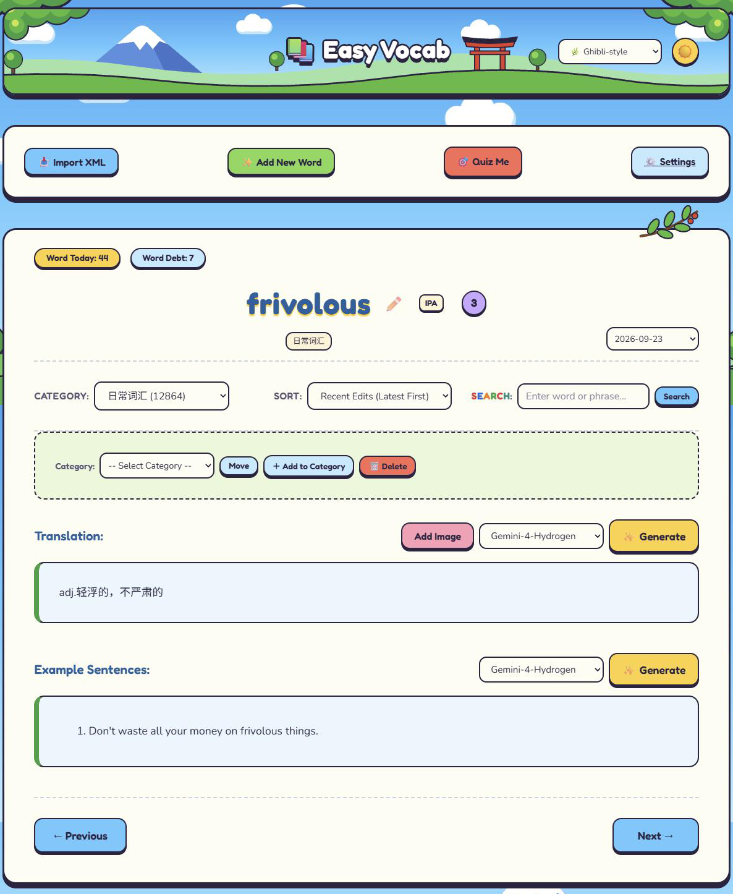
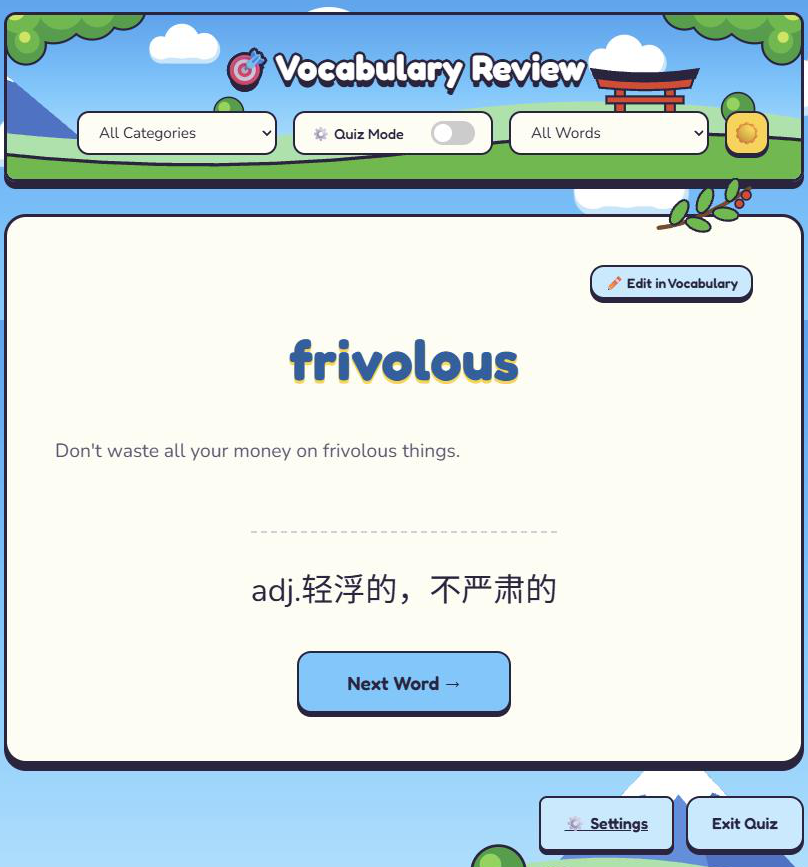
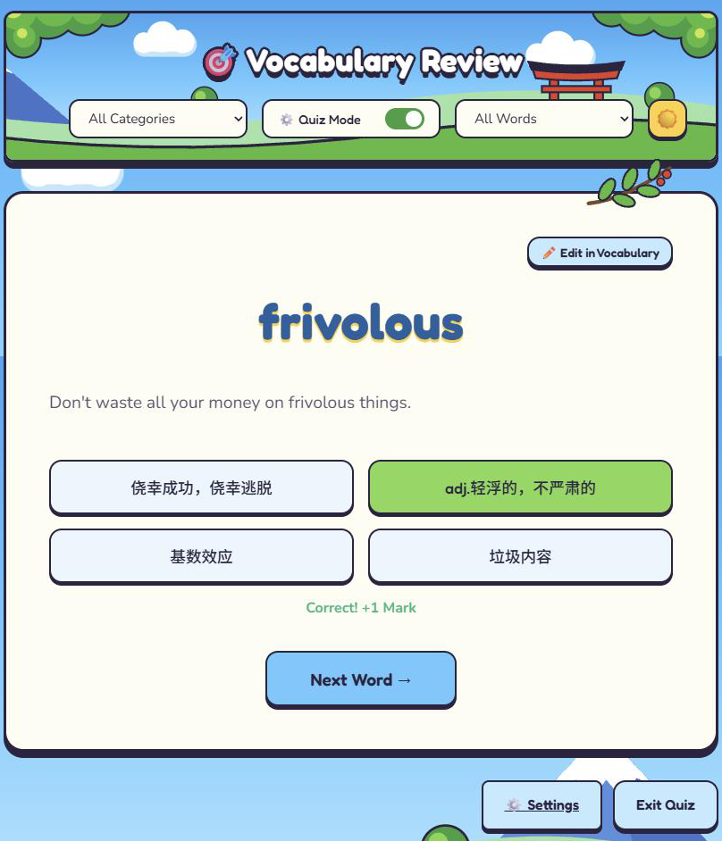
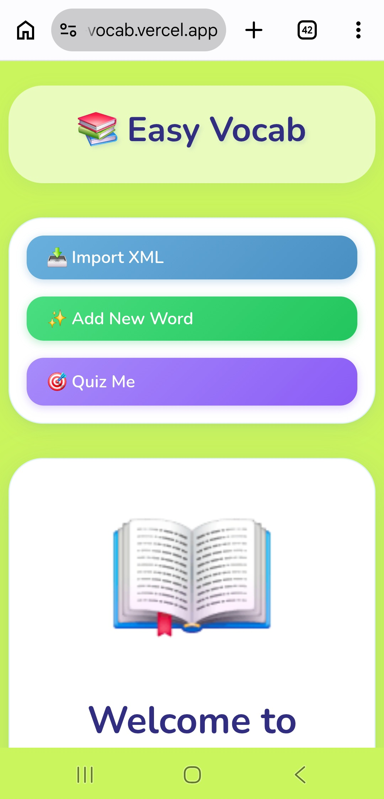
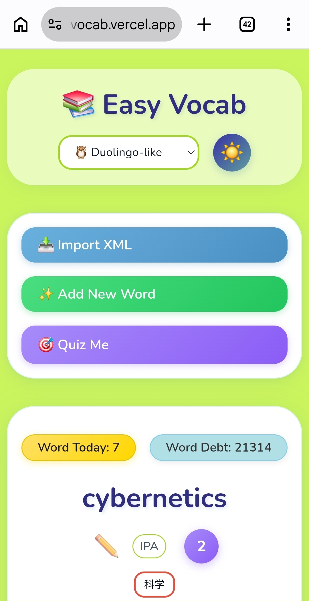
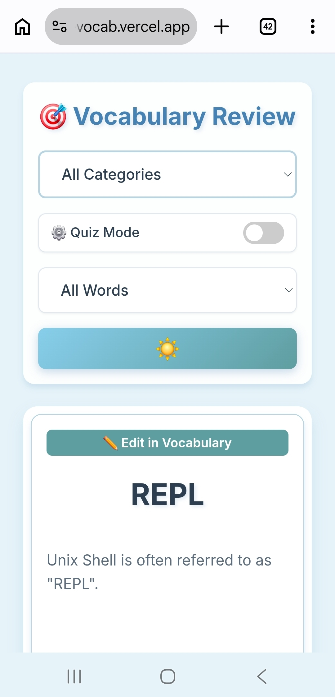

# EasyVocab - Vocabulary Learning App

**EasyVocab** is a personal vocabulary builder web app designed for English learners. It allows you to build your own vocabulary, review words and phrases in example sentences, and track your daily progress.


<p align="center">
  
</p>

## 🌟 Features

- **Cloud Hosted**: Deployed on Vercel with Aiven MySQL database for access anywhere
- **Secure Access**: Password-protected site with login rate limiting to prevent brute force attacks
- **AI-Powered Word Entry**: Auto-generate translations and example sentences with Google Gemini (Gemini 4 Hydrogen by default, or Gemini 3.5 Flash-Lite)
- **Private Word Images**: Attach pictures to a word; they live in your database and are shown only to logged-in users
- **Smart Quiz**: Spaced repetition based on the Ebbinghaus forgetting curve, with a flashcard mode, a multiple-choice mode (Gemini writes the wrong choices: other members of the answer's group, in the same format and word type; needs `GOOGLE_API_KEY`), Image-only / IPA-only filters and a daily progress chart
- **Browse by Category**: Organize and review vocabulary by 20+ categories, and file a word under more than one category
- **Interactive Word Cards**: Word, translation, example sentences, IPA, an optional picture and the word's categories on one card
- **Daily Tracking**: "Word Today" and "Word Debt" counters, plus a per-word edit history
- **Keyboard Navigation**: Use left/right arrow keys to quickly navigate between words
- **In-Place Editing**: Edit translations and add sample sentences directly in the interface
- **XML Import**: Bulk import vocabulary from XML files with validation and duplicate handling
- **Performance Optimized**: Handles 30,000+ words efficiently with database indexing
- **Themes**: 5 GUI themes (Default, Ghibli-style, Cyberpunk, Coral Neo, Duolingo-like) plus dark mode
- **Mobile Friendly**: Layout adapts to phones as well as desktop browsers

## 📸 Screenshots

### Quiz

<table>
  <tr>
    <td width="50%" valign="top"></td>
    <td width="50%" valign="top"></td>
  </tr>
  <tr>
    <td align="center"><sub>Flashcard mode</sub></td>
    <td align="center"><sub>Multiple-choice mode and daily progress chart</sub></td>
  </tr>
</table>

### Mobile

<table>
  <tr>
    <td width="33%" valign="top"></td>
    <td width="33%" valign="top"></td>
    <td width="33%" valign="top"></td>
  </tr>
  <tr>
    <td align="center"><sub>Welcome page</sub></td>
    <td align="center"><sub>Vocabulary page</sub></td>
    <td align="center"><sub>Quiz</sub></td>
  </tr>
</table>

## 🚀 Quick Start

You need **Python 3.11+**, **MySQL 8.0+** (local or hosted, e.g. Aiven) and **Git**. A free [Gemini API key](https://aistudio.google.com/apikey) is optional and only needed for the AI buttons.

**1. Install**

```bash
git clone https://github.com/maverick001/EasyVocab.git
cd EasyVocab
python -m venv .venv
.venv\Scripts\Activate.ps1        # macOS / Linux: source .venv/bin/activate
pip install -r requirements.txt
```

**2. Create the database.** Run these four scripts once each, in this order (MySQL Workbench or the command line):

```bash
mysql -u root -p < database/init_database.sql
mysql -u root -p < database/add_review_fields.sql
mysql -u root -p < database/update_schema_debt.sql
mysql -u root -p < database/create_daily_word_reviews.sql
```

The scripts use the database name `bkdict_db`; edit the `CREATE DATABASE` and `USE` lines if your host gives you another name. The app creates its remaining tables and columns itself on first start.

**3. Configure.** Copy `.env.example` to `.env` (`copy` on Windows, `cp` elsewhere) and fill in:

| Setting | Value |
|---------|-------|
| `DB_HOST`, `DB_PORT`, `DB_USER`, `DB_PASSWORD`, `DB_NAME` | Your MySQL details (locally: `localhost`, `3306`, your user, `bkdict_db`) |
| `SECRET_KEY` | A long random string: `python -c "import secrets; print(secrets.token_hex(32))"` |
| `SITE_PASSWORD` | The login password. An empty value turns the login off |
| `GOOGLE_API_KEY` | Your Gemini key (AI buttons only) |

> Replace every placeholder in `.env`, such as `your-site-password-here`, or it becomes your real value. `.env` is ignored by Git; never put real values in `.env.example`.

**4. Run**

```bash
python app.py
```

Open **http://localhost:5001** and log in. The server is reachable from other devices on your network, so keep `SITE_PASSWORD` set.

**5. Add words.** Click **Import XML File** and pick a file in the format below. The repo has no sample word lists, so write a small one.

```xml
<wordbook>
  <item>
    <word>example</word>
    <trans><![CDATA[n. 例子；示例]]></trans>
    <tags>文化</tags>
  </item>
</wordbook>
```

**6. Check (optional).** `python -m pytest test -q` runs the tests; no database needed.

**Common problems:** *can't connect to MySQL* → check the `DB_*` values and that MySQL is running. *"Gemini API Key not configured"* → set `GOOGLE_API_KEY`. After editing `.env`, restart the app.

### Docker (experimental, untested)

`docker compose up --build` uses the included `Dockerfile` and `docker-compose.yml`, which have not been built or tested yet. Inside a container `DB_HOST=localhost` points at the container, so use `host.docker.internal` (Docker Desktop) or your hosted database. Compose does not start MySQL, and the image uses Python 3.9 rather than the tested 3.11.

## 📖 Using the App

- **Browse:** pick a category, then move between words with the **← →** keys or the Previous/Next buttons.
- **Edit:** use **Edit** next to the translation or the sample sentence, then **Save**.
- **Images and AI models:** a word can have up to two pictures, stored in the MySQL table `word_images` and shown only to logged-in users, never kept on disk or in Git. Upgrading from pictures in `static/images/word_images/`? Run `python scripts/migrate_images_to_mysql.py` (add `--apply` to write). Two Gemini models are offered in the dropdowns (default set by `GEMINI_MODEL`):
  - `gemini-4-hydrogen`: a noun or noun phrase gets a sentence explaining what it is; any other word gets a plain everyday sentence.
  - `gemini-3.5-flash-lite`: one plain IELTS-level sentence for every word.

## 🛠️ Optional Monitoring

[Sentry](https://sentry.io) (errors) and [Langfuse](https://langfuse.com) (Gemini call traces) stay off until you set `SENTRY_DSN` or the `LANGFUSE_*` keys in `.env`; neither runs when `SKIP_DB=true`. Sentry comes with `requirements.txt`. Langfuse does not (its dependencies clash with the pinned `mysql-connector-python`), so install it yourself with `pip install langfuse` where you start the app. Traces go to Langfuse's cloud, not to your disk, and a Vercel deployment sends none.

## 📊 Database

The core tables are `words` and `categories`. The setup scripts and the app's first start also create `word_images`, `word_history`, `daily_study_log` and `daily_word_reviews`.

## 📝 License

This project is licensed under the MIT License.
